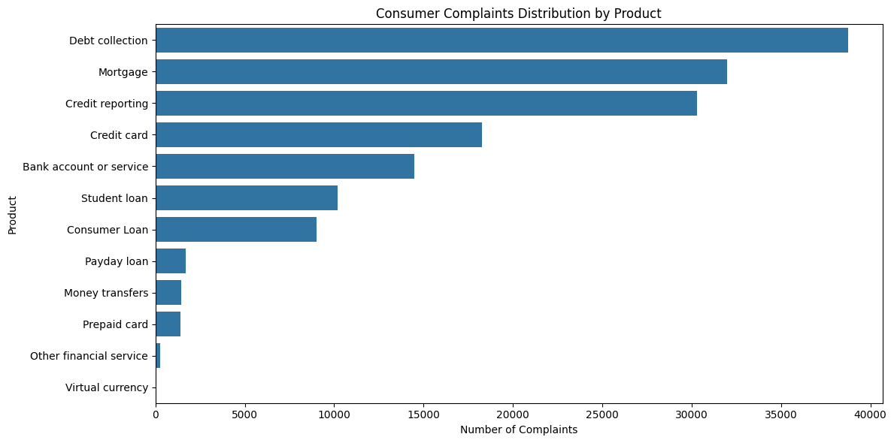
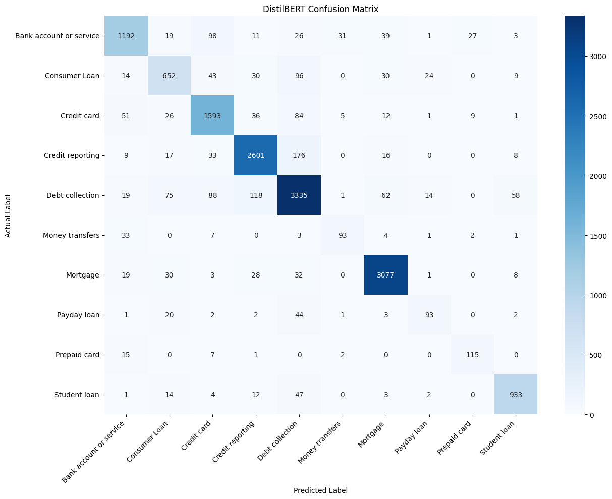

# Consumer Complaint Classification

Routes a consumer's financial complaint to the right product category from its free text. Four model types are compared, from a SimpleRNN to a fine-tuned DistilBERT, and DistilBERT is served in a Gradio app.

## Dataset

[Consumer Complaints](https://www.kaggle.com/datasets/heemalichaudhari/consumer-complaints) on Kaggle: 777,959 complaints, 157,865 of which have a written narrative.

- Classes with fewer than 500 samples were removed, leaving **10 product categories**
- Duplicates and texts with conflicting labels were removed, leaving **154,586 complaints**
- Stratified 80/10/10 split: 123,668 train, 15,459 validation, 15,459 test



## Results

Test set, 15,459 complaints:

| Model | Accuracy | Macro F1 | Weighted F1 |
|---|---|---|---|
| SimpleRNN (first attempt) | 13.5% | 0.07 | 0.13 |
| SimpleRNN V2 | 83.4% | 0.73 | 0.84 |
| GRU | 83.6% | 0.75 | 0.84 |
| LSTM | 84.4% | 0.76 | 0.85 |
| **DistilBERT** | **88.5%** | **0.82** | **0.88** |



## The SimpleRNN failure

The first SimpleRNN scored 13.5% and labelled 12,016 of 15,459 test complaints "Prepaid card", the rarest class. V2 reached 83.4% after these changes, made together:

- Class weights capped at 3.0 (they went up to 11.0)
- Padding masked with `mask_zero=True`
- Gradient clipping (`clipnorm=1.0`)
- Learning rate lowered from 1e-3 to 3e-4
- Dropout moved to the RNN input

## Approach

- **Recurrent models:** lowercasing, stopword removal (negations kept), lemmatization, 30,000-word vocabulary, 300-token sequences
- **DistilBERT:** `distilbert-base-uncased` with light cleaning, 256 tokens, 2 epochs, learning rate 2e-5

## Limitations

- Payday loan (F1 0.61) and Money transfers (F1 0.67) are the weakest DistilBERT classes; both have few samples.
- SimpleRNN V2's `fit` was called twice in a row, so it trained for more epochs than the other recurrent models.

## Demo

[demo/demo.mp4](demo/demo.mp4)

## Run it

1. Open [the notebook](notebooks/intelligent-routing-system.ipynb) on Kaggle with a GPU and internet enabled.
2. Attach the dataset above and check that `DATA_PATH` matches.
3. Run the cells in order. The Gradio app is near the end.

To work locally, run `pip install -r requirements.txt` and change the `/kaggle/...` paths. Trained weights are not included.

## Structure

```
├── notebooks/intelligent-routing-system.ipynb
├── assets/
├── demo/demo.mp4
├── requirements.txt
└── README.md
```
